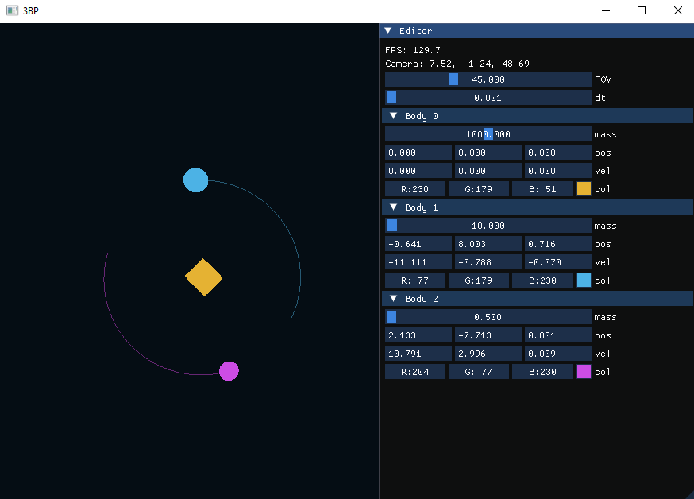

# GravitySim


[](https://en.wikipedia.org/wiki/C%2B%2B)  
[](https://www.opengl.org/)  
[](https://en.wikipedia.org/wiki/X64)  

<a href="https://github.com/NiQkir1/GravitySim"></a>

---

## About

**3D Gravity Simulation** — это интерактивная визуализация N-body системы с поддержкой физики, столкновений и управления камерой. Проект создан для демонстрации принципов гравитационного взаимодействия и визуализации динамики тел в трёхмерном пространстве.



### Основные возможности:

- **3D визуализация N-body системы**  
  Отображение произвольного количества тел в пространстве с плавной анимацией.

- **Физика гравитации**  
  Реалистичная симуляция движения тел под действием закона всемирного тяготения.  
  Поддержка оптимизации взаимодействий (ограничение радиуса).

- **Столкновения**  
  Обработка упругих и неупругих столкновений с визуальными эффектами (вспышки, слияния).

- **Траектории движения**  
  Запись и отображение траекторий каждого тела для анализа динамики.

- **Камера и управление**  
  - WASD для перемещения  
  - Мышь для поворота  
  - Scroll для масштабирования  
  - Поддержка свободного полёта

- **Расширенные свойства тел**  
  Тип (звезда, планета, астероид), форма (куб/сфера), цвет, размер, вращение.

- **Графика**  
  Использование OpenGL 3.3, ImGui для интерфейса, поддержка кубов и сфер.

---

## Technologies

- **OpenGL 3.3** — рендеринг  
- **GLFW / GLAD** — управление окном и контекстом  
- **ImGui** — графический интерфейс пользователя  

---


## Гравитация Ньютона
Используется классическая формула гравитации:


$$F_{ij} = \frac{G m_i m_j}{r_{ij}^2}$$


### Особенности
- Ограничение радиуса взаимодействия: `maxInteractionRadius = 50.0`.
- При \(r < 10^{-4}\) взаимодействие игнорируется (защита от деления на ноль).
- Нет мягкого ядра — сила растёт резко при малых расстояниях.

---

## Интегратор (явный Эйлер)
Простая схема обновления:


$$\mathbf{v}(t+\Delta t) = \mathbf{v}(t) + \mathbf{a}(t)\Delta t$$


$$\mathbf{x}(t+\Delta t) = \mathbf{x}(t) + \mathbf{v}(t)\Delta t$$


### Особенности
- Простая и быстрая реализация.
- Энергия системы сохраняется хуже, чем у Верле.
- Для статичных тел обновляется только вращение и траектория.

---

## Столкновения

### Упругие столкновения
- Используется формула обмена скоростями вдоль нормали.
- Тела раздвигаются, чтобы исключить пересечение.
- Добавляется визуальный эффект вспышки (`collisionFlash`).

### Неупругие столкновения (слияние)
- Более массивное тело поглощает меньшее.
- Масса суммируется, радиус увеличивается на 15%.
- Меньшее тело помечается как `isStatic` и фактически удаляется из симуляции.

---

## Вращение тел
Каждое тело имеет:
- `rotationAngle` — текущий угол.
- `rotationAxis` — ось вращения.
- `rotationSpeed` — скорость вращения.

### Особенности
- Вращение обновляется даже для статичных тел.
- Угол нормализуется в диапазоне \([0, 2\pi]\).

---

## Траектории
Для каждого тела ведётся история позиций:
- `trajectory` — список точек.
- Ограничение: максимум 500 точек.
- Добавление точки происходит:
  - Каждые `trajectoryStride` шагов.
  - Если тело прошло расстояние больше `trajectoryMinDist`.

**Результат:** траектории отображаются плавно и не перегружают память.

---

## Визуальные эффекты
- `collisionFlash` — яркость вспышки при столкновении.
- `collisionFlashDecay` — скорость затухания.
- Цвет тела задаётся параметром `color`.

---

## Видео

**Видео 1: Траектории, управление камерой, редактор тел**

[](https://youtu.be/sOJfyTnC7Qo)

**Видео 2: Упругое столкновение и визуальные эффекты**

[](https://youtu.be/rnDIil25AS8)

**Видео 3: НЕ упругое столкновение(слияние)**

[](https://youtu.be/Br8nUahubaM)


## Build & Run

1. Установите зависимости:  
   - GLFW  
   - GLAD  
   - ImGui  

2. Склонируйте репозиторий:
   ```bash
   git clone https://github.com/NiQkir1/GravitySim.git
   cd GravitySim
